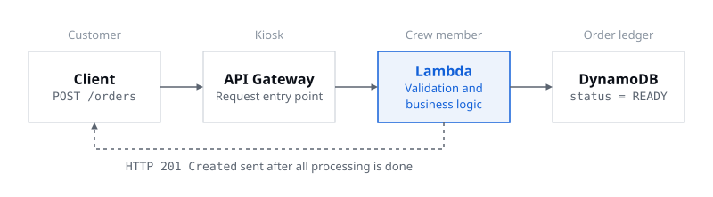
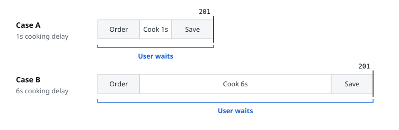

> What goes away isn't the server, but the burden of running it yourself

I gave the first talk in Session 03. Last session looked at compute services like EC2 and ECS; this time we followed how a request is handled in a serverless environment, centered on AWS Lambda. I tend to make sense of new concepts by comparing them to something familiar, so this time, too, I imagined running a branch of McDonald's, my favorite burger place. We built the system one piece at a time, from taking a Big Mac order to cooking it and recording the order's status, and at the end we deployed an event sign-up service with the same structure ourselves to check it.

## 01. Serverless still has servers

Going by the name, serverless sounds like there are no servers at all. But running a service takes a computer to execute the code, so of course there are servers. The point of serverless is **to reduce the burden of preparing and running servers yourself**.

Here's how the work splits. AWS prepares the runtime environment, scales capacity, and operates the infrastructure. Developers write the code that decides which requests to handle and how, and design the data, permissions, and error handling. Preparing and allocating the resources a service needs is called provisioning, and with serverless, AWS takes on a large part of this infrastructure work.

Let's carry this over to McDonald's. If I owned the store, the traditional way, I'd prepare the store and the kitchen and hire and schedule the crew myself. When more customers come in, I add crew; when fewer come, I cut back. Using EC2 with Auto Scaling is similar. The number of servers adjusts automatically, but some things are still yours to look after, like the operating system and the instances.

But if I hand the kitchen and the staffing over to a specialist firm, all I have to decide is which orders the crew handle and how. Serverless with Lambda works much the same way. Developers prepare the function code and settings, and AWS takes care of setting up and scaling the runtime environment. **What developers focus on shifts from running servers to the logic for handling orders.**


## 02. Lambda isn't always the better choice

You might be wondering: EC2 already scales automatically with Auto Scaling, so why bother with Lambda? When I first compared them, I assumed Lambda would naturally be more efficient when there's a lot to process. But while both scale automatically, they scale in different units and leave you different things to manage.

| | EC2 + Auto Scaling | AWS Lambda |
|---|---|---|
| Unit of execution | Virtual server instance | Function runtime environment |
| What you manage | Running the OS and instances | AWS manages the runtime infrastructure |
| How it scales | Adjusting the number of instances | Concurrent executions grow with requests |
| What you pay for | Mainly instance running time | Mainly invocations and the resources each run uses |
| Good fit | Long-running work, fine control over the environment | Intermittent or highly variable work |

That doesn't make Lambda the more efficient choice every time. For a store like the one in Myeongdong, Seoul's busy shopping district, where customers keep coming around the clock, a kitchen that runs all the time can be more efficient. The amount and nature of the work like this is called the workload. What matters isn't deciding that one approach is always better, but **choosing the service that fits the workload**.

## 03. How does Lambda know an order came in?

I said Lambda runs when there's a request. So how does it know an order has come in? Lambda isn't always on, watching for new orders. An event or invocation passed along by another service is what starts a function. A user sending an HTTP request, uploading a file, or a change in data can all set off an execution. Here, **an event is something that happened in the system, or an input that sets off work**.

At McDonald's, that's the moment a customer presses the order button on the kiosk. The crew don't notice the order on their own; the ordering counter calls them. The tap on the kiosk becomes a request received by API Gateway, which in turn becomes a Lambda invocation.

## 04. The path one order takes

Now let's build the ordering system piece by piece.

**The kiosk is API Gateway.** When you order a Big Mac, you don't walk into the kitchen and ask the crew to make it. You pick from the menu at the kiosk and pay, and the order is placed. You don't need to know how the kitchen is laid out; you just use the ordering counter that's there for you. Amazon API Gateway plays this role. It takes users' HTTP requests and passes them to the backend service connected to it, and clients send their requests to a fixed API address. In the example, when the customer pays, API Gateway receives a `POST /orders` request, order #9907 is placed, and that leads to a Lambda invocation. The key point is that **API Gateway doesn't make the Big Mac**. It's simply the entrance for requests.

**The crew member is AWS Lambda.** Now that the order's in, someone has to actually handle it. The crew member looks at the order ticket, checks what was ordered, and starts cooking. On AWS, this job goes to Lambda, a serverless compute service that runs in response to events or invocations. One concept to know here is the handler. **The handler is the function's entry point, where execution begins when Lambda is invoked**, and the placed order becomes the handler's input. The handler receives the order data, checks that the required values are there, saves the order information, and then runs the business logic step by step. Business logic sounds complicated, but it's just the rules the service actually has to carry out. Here, that's making the Big Mac.

**The order ledger is DynamoDB.** The job isn't over once the Big Mac is made. There has to be a record that order 9907 was handled properly. If the crew member only keeps the result in their head, it gets hard to tell whether earlier orders were finished once shifts change or new orders come in. So **the fact that an order is done goes in the ledger, not in the crew member's memory**. Amazon DynamoDB is AWS's fully managed, serverless NoSQL database, and here it's the ledger where order numbers and their status are written down. Once #9907's status is saved as READY, the next request can look up the result in the same ledger with the same order number.

Put the services so far in one line and you get this. When a customer orders, the client sends an HTTP request, and API Gateway receives it and passes it to Lambda. Lambda checks that the order information is valid, runs the business logic that makes the Big Mac, and saves the result in DynamoDB as `status = READY`. When everything is done, Lambda returns an HTTP 201 Created response, and the user checks the result with the same order number. That's the basic structure of serverless order processing.



## 05. Does the next crew member remember earlier orders?

The structure is done, but running it for real raises a few more questions. First, can Lambda remember the state of earlier runs? If a crew member keeps count of the orders they've handled only in their head and then goes home, the next person on shift can't pick up that number.

Lambda is similar. A request may be handled by reusing an existing runtime environment, or it may start in a new one. Reusing an existing environment is called a warm start, and initializing a new runtime environment to start is called a cold start. So you can't assume, as the code below does, that a value stored in the runtime environment's memory will still be there on the next invocation.

```python
total_orders = 0

def lambda_handler(event, context):
    global total_orders
    total_orders += 1
    return total_orders
```

This leads to the idea of statelessness: designing so you don't rely on the memory state of an earlier runtime environment. Information the next invocation also needs, like order numbers and processing status, goes in **an external store such as DynamoDB**.


## 06. Giving the new hire the combination to the safe?

A new part-timer has joined our McDonald's. Their job is to check orders and make Big Macs. But what if, on top of access to the order ledger, you also gave them permission to delete sales records and to open the safe? There's no need for it, and it could go very wrong.

AWS is the same. For Lambda to access DynamoDB, it needs the right permissions, and the role you give Lambda for this is called an IAM execution role. Handling orders only takes permission to read, save, and update data.

| | Permissions |
|---|---|
| Needed | `dynamodb:GetItem`, `dynamodb:PutItem`, `dynamodb:UpdateItem` |
| Not needed | Deleting tables, reading other data, administrator access |

Giving only the minimum permissions a job needs is called the **principle of least privilege**. AWS managing the servers for you doesn't mean a function can freely access any resource.

## 07. A function can't run forever

Now say a crew member takes far too long on a single order. Once Lambda starts running, can it keep going with no limit? No. Lambda has a **timeout, the maximum time a function is allowed to run**, and execution stops once it's exceeded.

In the hands-on later, we set the timeout to 10 seconds. Counting from the start of execution at 0 seconds, the 6-second delay we add in the hands-on stays within the limit, but past 10 seconds the work may not finish properly. So developers also have to think about what happens to work that's already in progress. The code has to take responsibility for whatever was done right before the stop, and a warm start isn't a feature that resumes a stopped function from where it left off.

## 08. Synchronous processing: waiting until the Big Mac is ready

Let's look at our ordering system again. A customer orders a Big Mac at the kiosk, API Gateway takes the order and passes it to Lambda, and Lambda saves the order and makes the Big Mac. In this setup, the customer has to wait for the final response until the Big Mac is made and the result is saved. This way of working, where **the side that made the request waits for the result before moving on**, is called synchronous processing.

There's one distinction I found confusing myself. Lambda being able to handle many requests at once is a different matter from each requester waiting for their own result. Even if several crew members make Big Macs at the same time, if each customer waits for their own order to finish, it's synchronous processing. Concurrency is about how much gets handled at once; **synchronous versus asynchronous is about how you wait for the result**.

So what happens if cooking a Big Mac goes from 1 second to 6 seconds? In the current setup, the final response only comes back once the Big Mac is done, so the user waits that much longer too. What matters here isn't so much that Lambda gets slower, but that **the time the follow-up work takes is added straight onto the user's wait for a response**. The actual HTTP response time also includes the network and other processing, so it won't be exactly 1 or 6 seconds. We see this difference for ourselves in the hands-on.



## 09. Hands-on: handling a request and checking what was saved

We turned the ordering system from the talk into an event sign-up service and deployed it ourselves. Instead of orders it takes sign-ups, and instead of Big Macs it issues badges. API Gateway is the entrance that takes sign-ups, Lambda is the crew member who handles them, and DynamoDB is the ledger for sign-ups and badges. In this setup, the response comes only after the badge has been issued. The goal was to connect one sign-up's response, logs, and database record through the same registration ID, and to see how the response time changes when issuing slows down.

You deploy with commands and check the results on the sign-up page and in the AWS console. The source is in [`session-03/source` in the Cohort 1 assignments repository](https://github.com/AWS-Student-Builder-Group-at-UOS/cohort-01-assignments/tree/main/session-03/source), and screenshots of each screen and the full set of commands are in the hands-on guide for your operating system ([macOS, Linux, and CloudShell](files/hands-on-macos-linux.pdf) or [Windows](files/hands-on-windows.pdf), in Korean). The commands below are for macOS, Linux, and CloudShell. In Windows PowerShell, you paste the setup block from the guide and then do the same things with functions like `Deploy-Step1`. The sign-up page is in Korean, so its labels appear below with their meaning in parentheses.

### Before you start

Pick the terminal you'll deploy from: CloudShell or your own computer. With CloudShell, you upload `source.zip` in the AWS console; on your own computer, have the AWS CLI login, the SAM CLI, Python 3.9 or later, and `make` ready. Run every command from the `source/` folder, where the `Makefile` is, and set the console region to Seoul (`ap-northeast-2`).

If you're deploying from your own computer, finish the AWS CLI login before the session. Instead of using the root account, create an IAM user, attach `AdministratorAccess` temporarily for practice, then create an access key for the CLI and enter it in `aws configure`. You're set when the `Arn` from `aws sts get-caller-identity` shows the user you created. An access key is as good as a password, so keep it out of chats, screenshots, repositories, and your assignment README.

```bash
make doctor
make test
```

`make doctor` checks for missing tools and the login, and `make test` runs the basic tests that don't call AWS. In PowerShell, `Test-Setup` and `py -m unittest -b tests.test_handlers -v` do the same jobs.

Open the sign-up page from a local server on your computer. If you open `web/index.html` directly as a file, the browser sends `null` as the origin and the API calls are blocked with a CORS error. Open one more terminal window, run the command below from the `source/` folder, and open `http://localhost:8000/` in your browser.

```bash
python3 -m http.server 8000 --directory web
```

If several people share one AWS account, each person picks their own stack name so they don't collide. If you don't set one, the stack is named `event-signup`. The lab API has no authentication, so use made-up names and email addresses.

```bash
export STACK=event-signup-yourname
export REGION=ap-northeast-2
```

### 1. Deploy and connect

```bash
make step1
```

`sam deploy` creates or updates the stack, and when it finishes, the last line prints an API address that looks like `https://<string>.execute-api.ap-northeast-2.amazonaws.com`. If you don't see the address, run `make url`.

A single command creates the function, the table, and the API all at once thanks to AWS SAM (Serverless Application Model). You list the resources you need in a YAML template like `step1/template.yaml`, and SAM deploys them through CloudFormation. CloudFormation is an infrastructure as code (IaC) service, so you can see everything that was created under CloudFormation → Stacks → your stack in the console.

Check that the stack status is `CREATE_COMPLETE`, and if it failed, read the earliest failure reason on the **Events** tab. The **Resources** tab has exactly the setup from the talk: `RegisterFunction`, which takes sign-ups; `StatusFunction`, which looks up their status; `RegistrationsTable`, the ledger; and `Api`, the entrance. Last, on the sign-up page, choose `실습 1 · 동기` (Lab 1, synchronous), paste the address into the `API 주소` (API address) field, and click `적용` (Apply). Applying the address doesn't mean the deployment succeeded, so check the deployment status in CloudFormation.

### 2. Connect the response, logs, and database through one registration ID

Leave the prefilled values (the name `홍길동` and the affiliation `ASBG`) as they are, click `신청하기` (Sign up), and note the registration ID on the screen (`reg-…`). You check three places with this one ID.


- **Response:** Under `상세 보기` (Details), check that `HTTP 응답` (HTTP response) is `201`, and look at `응답 시간` (Response time) and the badge code (`BADGE-…`). The response arrives only after the badge has been issued.
- **Logs:** Keep `make logs F=RegisterFunction` running in another terminal window, or in CloudWatch → Logs Insights, choose the log group `/asbg/<stack name>/register` and run the query below over the last 30 minutes. The records appear in the order `request_received → registration_saved → badge_made → badge_saved`.
- **Database:** In DynamoDB → Explore items, choose your table, find the registration ID, and check `status = ISSUED` and `badgeCode`. The table name is under the stack's **Outputs → TableName**, and in the terminal, `make db` shows the same thing as a table.

```text
fields @timestamp, @message
| filter @message like "your registration ID"
| sort @timestamp asc
```

You're done when the registration ID and the badge code match across the page, the logs, and the database. Also make sure you aren't looking at someone else's stack or an earlier sign-up.

### 3. When issuing slows down

In Lambda → your stack's `RegisterFunction` → Configuration → Environment variables → Edit, change `ISSUE_DELAY_SECONDS` to **6** and save. This value deliberately makes issuing a badge take longer. Sign up again with `새 번호` (New ID) → `신청하기` (Sign up) and compare the response time with the previous sign-up: it's roughly the 6-second issuing delay plus the time for invoking and saving. In the guide's screenshots too, a response that took 2.02 seconds grew to 7.02 seconds. Just as we saw in the talk, **the issuing delay goes straight into the user's response time**.

After you've recorded the comparison, set the value back to its original **1**. Redeploying the same template doesn't always overwrite a value changed in the console, so you have to restore it yourself, and the final settings for the assignment belong in the template and the code. If you have time, raise the delay to 15 seconds to go past the 10-second timeout. You'll get an error response and timeout logs, and the database keeps the sign-up that never got as far as issuing in the `RECEIVED` state. For the exact HTTP error code, record what you actually see.

### After the hands-on

This stack carries over to Lab 2 in the next talk. Deploy `make step2 DELAY=6` with the same folder, stack name, and region, and the asynchronous setup is added on top of the existing table and API. Once you're done with the hands-on and have checked your assignment, delete the stack with `make delete`, confirm in CloudFormation that the deletion finished, and then also remove the practice IAM user's access key and its `AdministratorAccess`.

After waiting out the full 6-second issuing delay, a question comes up. Do we really have to wait until the Big Mac is ready? Even at McDonald's, once your order is placed you get an order number first and the burger later. If it's really busy, you might even pop over to a nearby convenience store in the meantime. Couldn't we take the order first and cook it later? That question, splitting taking an order from processing it, is where the asynchronous architecture in the next talk begins.
