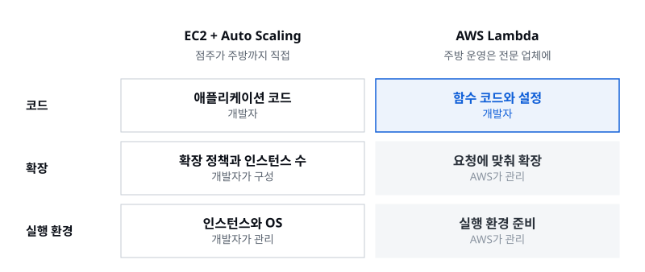
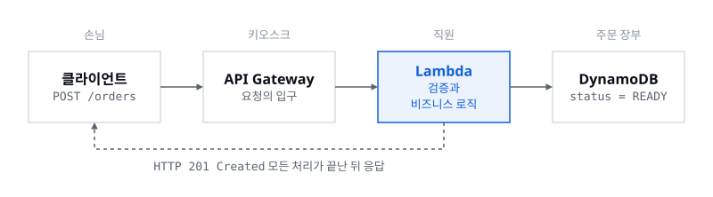
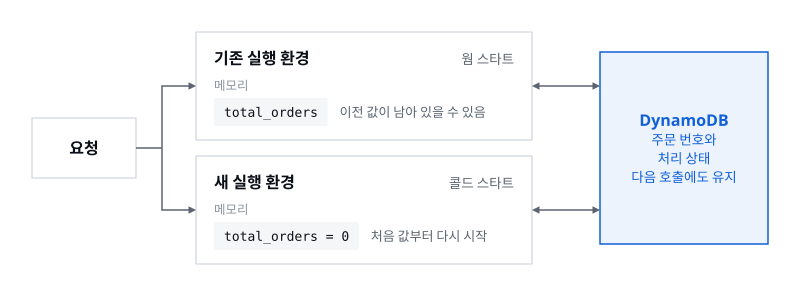
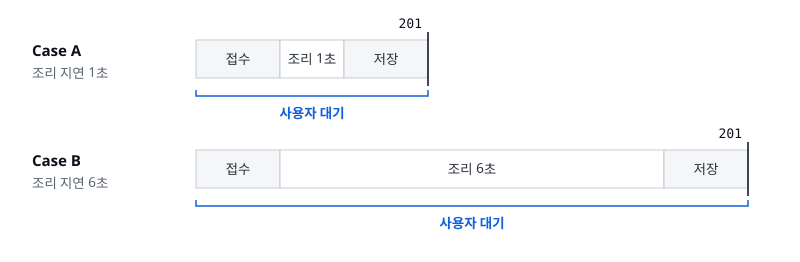
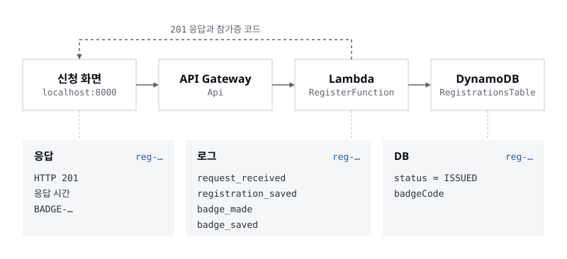

> 줄어드는 것은 서버가 아니라, 서버를 직접 운영하는 부담입니다

세션 03의 첫 발표를 맡았습니다. 지난 세션에서 EC2와 ECS 같은 컴퓨팅 서비스를 살펴봤다면, 이번에는 AWS Lambda를 중심으로 서버리스 환경에서 요청이 어떻게 처리되는지 따라갔습니다. 저는 처음 배우는 개념을 익숙한 것에 빗대어 이해하는 습관이 있어서, 이번에도 제가 제일 좋아하는 햄버거 가게인 맥도날드 매장 하나를 운영한다고 가정했습니다. 빅맥 주문을 받는 것부터 조리하고 주문 상태를 기록하는 것까지 하나씩 만들어 보고, 끝에서는 같은 구조의 행사 신청 서비스를 직접 배포해 확인했습니다.

## 01. 서버리스에도 서버는 있다

이름만 보면 서버리스(Serverless)는 서버가 없는 구조 같습니다. 하지만 서비스를 운영하려면 결국 코드를 실행할 컴퓨터가 필요하니, 서버는 당연히 있습니다. 서버리스의 핵심은 **서버를 직접 준비하고 운영하는 부담을 줄이는 것**입니다.

일을 나누면 이렇습니다. AWS는 실행 환경을 준비하고, 용량을 확장하고, 인프라를 운영합니다. 개발자는 어떤 요청을 어떻게 처리할지 코드를 쓰고, 데이터와 권한, 오류 처리를 설계합니다. 서비스에 필요한 자원을 준비하고 할당하는 과정을 프로비저닝(provisioning)이라고 하는데, 서버리스에서는 이 인프라 관리 작업의 상당 부분을 AWS가 대신 맡습니다.

맥도날드로 옮겨 보겠습니다. 제가 점주라면, 기존 방식에서는 매장과 주방 시설을 준비하고 직원도 직접 고용해 배치해야 합니다. 손님이 많아지면 직원을 더 넣고, 적어지면 줄입니다. EC2에 Auto Scaling을 쓰는 것도 비슷합니다. 서버 수는 자동으로 조절되지만, 운영체제와 인스턴스 관리처럼 사용자가 챙겨야 하는 영역이 여전히 남습니다.

그런데 주방 시설 관리와 인력 배치를 전문 업체에 넘기면, 저는 직원이 어떤 주문을 어떻게 처리할지만 정하면 됩니다. Lambda를 쓰는 서버리스 방식이 이와 비슷합니다. 개발자는 함수 코드와 설정을 준비하고, 실행 환경을 구성하고 확장하는 일은 AWS가 맡습니다. **개발자가 집중하는 대상이 서버 운영에서 주문 처리 로직으로 옮겨 가는 겁니다.**



## 02. 무조건 Lambda가 나은 건 아니다

여기서 궁금해질 수 있습니다. EC2도 Auto Scaling으로 자동 확장이 되는데, 굳이 Lambda를 쓰는 이유는 뭘까요? 저도 처음 비교했을 때는 처리량이 많으면 당연히 Lambda가 효율적이라고 생각했습니다. 그런데 두 방식 모두 자동으로 확장되지만, 확장하는 단위와 관리해야 하는 대상이 다릅니다.

| 구분 | EC2 + Auto Scaling | AWS Lambda |
|---|---|---|
| 실행 단위 | 가상 서버 인스턴스 | 함수 실행 환경 |
| 관리 범위 | OS와 인스턴스 운영 | AWS가 실행 인프라 관리 |
| 확장 방식 | 인스턴스 수 조정 | 요청에 맞춰 동시 실행 증가 |
| 비용 기준 | 주로 인스턴스 실행 시간 | 주로 호출 수와 실행 자원 |
| 잘 맞는 작업 | 지속 실행, 세밀한 환경 제어 | 간헐적이거나 변동이 큰 작업 |

그렇다고 Lambda가 무조건 효율적인 것도 아닙니다. 명동처럼 24시간 손님이 끊이지 않는 매장이라면 계속 돌아가는 주방이 더 효율적일 수 있습니다. 이런 작업의 양과 특성을 워크로드(workload)라고 부릅니다. 중요한 건 어떤 방식이 무조건 좋다고 판단하는 게 아니라, **워크로드에 맞는 서비스를 고르는 것**입니다.

## 03. Lambda는 주문이 들어온 걸 어떻게 알까

Lambda는 요청이 있을 때 실행된다고 했습니다. 그러면 주문이 들어왔다는 사실은 어떻게 알까요? Lambda가 항상 켜져서 새 주문이 들어오는지 지켜보고 있는 건 아닙니다. 다른 서비스가 전달한 이벤트나 호출이 함수 실행의 출발점이 됩니다. 사용자가 HTTP 요청을 보내거나, 파일을 업로드하거나, 데이터가 바뀌는 일이 모두 실행의 계기가 될 수 있습니다. 여기서 **이벤트는 시스템에서 발생한 사건, 또는 작업을 유발하는 입력**입니다.

맥도날드에서는 손님이 키오스크에서 주문 버튼을 누르는 순간입니다. 주문이 들어왔다는 걸 직원이 스스로 알아채는 게 아니라, 주문 창구가 직원을 부릅니다. 키오스크 버튼 클릭이 API Gateway의 요청 수신으로, 다시 Lambda 호출로 이어집니다.

## 04. 주문 하나가 지나가는 길

이제 주문 시스템을 하나씩 만들어 보겠습니다.

**키오스크는 API Gateway입니다.** 빅맥을 주문할 때 손님이 주방에 들어가 직원에게 직접 만들어 달라고 하지는 않습니다. 키오스크에서 메뉴를 고르고 결제하면 주문이 접수됩니다. 손님은 주방 구조를 몰라도 정해진 주문 창구만 이용하면 됩니다. Amazon API Gateway가 이 역할을 합니다. 사용자의 HTTP 요청을 받아 연결된 백엔드 서비스로 전달하고, 클라이언트는 정해진 API 주소로 요청을 보냅니다. 예시에서는 손님이 결제하면 API Gateway가 `POST /orders` 요청을 받고, 주문 #9907이 접수되어 Lambda 호출로 이어집니다. 중요한 점은 **API Gateway가 빅맥을 만들지는 않는다**는 겁니다. 말 그대로 요청의 입구입니다.

**직원은 AWS Lambda입니다.** 주문을 받았으니 실제로 처리할 직원이 필요합니다. 직원은 주문표를 보고 어떤 메뉴인지 확인한 뒤 조리를 시작합니다. AWS에서는 이벤트나 호출에 따라 실행되는 서버리스 컴퓨팅 서비스인 Lambda가 이 일을 맡습니다. 여기서 알아 둘 개념이 핸들러(handler)입니다. **핸들러는 Lambda가 호출됐을 때 실행을 시작하는 함수의 진입점**이고, 접수된 주문이 핸들러의 입력이 됩니다. 핸들러는 주문 데이터를 받아 필수값이 제대로 들어왔는지 검증하고, 주문 정보를 저장한 뒤 비즈니스 로직을 순서대로 실행합니다. 비즈니스 로직은 어렵게 들리지만, 서비스가 실제로 처리해야 하는 업무 규칙입니다. 여기서는 빅맥을 만드는 일이죠.

**주문 장부는 DynamoDB입니다.** 직원이 빅맥을 완성했다고 일이 끝나지는 않습니다. 주문번호 9907번이 제대로 처리됐는지 기록이 남아야 합니다. 직원이 처리 결과를 머릿속에만 기억하면, 교대하거나 새 주문이 들어왔을 때 이전 주문이 끝났는지 확인하기 어렵습니다. 그래서 **처리가 끝났다는 사실은 직원의 기억이 아니라 장부에** 남깁니다. Amazon DynamoDB는 AWS가 제공하는 완전 관리형 서버리스 NoSQL 데이터베이스이고, 여기서는 주문 번호와 처리 상태를 적는 장부입니다. #9907의 상태를 READY로 저장해 두면, 다음 요청도 같은 장부에서 같은 주문 번호로 결과를 조회할 수 있습니다.

지금까지 나온 서비스를 한 줄로 이으면 이렇습니다. 손님이 주문하면 클라이언트에서 HTTP 요청이 발생하고, API Gateway가 이를 받아 Lambda에 전달합니다. Lambda는 주문 정보가 올바른지 확인하고 빅맥을 만드는 비즈니스 로직을 실행한 뒤, 결과를 DynamoDB에 `status = READY`로 저장합니다. 모든 작업이 끝나면 Lambda가 HTTP 201 Created 응답을 돌려주고, 사용자는 같은 주문 번호로 처리 결과를 확인합니다. 이것이 기본적인 서버리스 주문 처리 구조입니다.



## 05. 직원이 바뀌면 이전 주문을 기억할까

구조는 완성됐지만, 실제로 운영하려면 생각할 문제가 몇 가지 더 있습니다. 먼저 Lambda가 이전 실행 상태를 기억할 수 있는지입니다. 직원이 자기가 처리한 주문 개수를 머릿속에만 세고 있다가 퇴근하면, 다음에 온 직원은 그 숫자를 그대로 이어받을 수 없습니다.

Lambda도 비슷합니다. 요청을 처리할 때 기존 실행 환경을 재사용할 수도 있지만, 새 실행 환경에서 시작할 수도 있습니다. 기존 환경을 재사용하는 것을 웜 스타트(warm start), 새 실행 환경을 초기화해서 시작하는 것을 콜드 스타트(cold start)라고 합니다. 그래서 아래 코드처럼 실행 환경 메모리에 저장한 값을 다음 호출에서도 그대로 쓸 수 있다고 가정하면 안 됩니다.

```python
total_orders = 0

def lambda_handler(event, context):
    global total_orders
    total_orders += 1
    return total_orders
```

여기서 이어지는 개념이 무상태성(stateless)입니다. 이전 실행 환경의 메모리 상태에 기대지 않도록 설계하는 것이죠. 주문 번호나 처리 상태처럼 다음 호출에도 필요한 정보는 **DynamoDB 같은 외부 저장소에** 둡니다.



## 06. 신입 직원에게 금고 비밀번호까지?

맥도날드에 새 아르바이트생이 들어왔습니다. 맡은 일은 주문을 확인하고 빅맥을 만드는 겁니다. 그런데 주문 장부를 보는 권한에 더해 매출 정보를 지우는 권한, 금고를 여는 권한까지 다 준다면 어떨까요? 그럴 필요도 없고, 큰일이 납니다.

AWS도 마찬가지입니다. Lambda가 DynamoDB에 접근하려면 알맞은 권한이 있어야 하고, 이때 Lambda에 부여하는 역할을 IAM 실행 역할(execution role)이라고 합니다. 주문 처리에 필요한 건 데이터를 조회하고 저장하고 수정하는 권한뿐입니다.

| 구분 | 권한 |
|---|---|
| 필요한 권한 | `dynamodb:GetItem`, `dynamodb:PutItem`, `dynamodb:UpdateItem` |
| 불필요한 권한 | 테이블 삭제, 다른 데이터 조회, 관리자 권한 |

이렇게 업무에 필요한 최소한의 권한만 주는 것을 **최소 권한 원칙**이라고 합니다. AWS가 서버를 관리해 준다고 해서 함수가 어떤 리소스에든 자유롭게 접근할 수 있는 건 아닙니다.

## 07. 함수가 끝없이 실행될 수는 없다

이번에는 직원이 주문 하나를 처리하는 데 너무 오래 걸리는 상황입니다. Lambda는 한 번 실행되면 제한 없이 계속 동작할 수 있을까요? 아닙니다. Lambda에는 **타임아웃(timeout), 즉 함수 실행에 허용된 최대 시간**이 있고, 이 시간을 넘기면 실행이 중단됩니다.

뒤의 실습에서는 타임아웃을 10초로 정했습니다. 0초에 실행을 시작해 실습에서 넣는 6초의 지연까지는 제한 시간 안에 들어오지만, 10초를 넘기면 작업을 정상적으로 마무리하지 못할 수 있습니다. 그래서 이미 진행한 작업을 어떻게 처리할지도 개발자가 고려해야 합니다. 중단 직전까지 끝난 작업은 코드가 책임져야 하고, 웜 스타트는 중단된 함수를 이전 위치에서 이어 실행하는 기능이 아닙니다.

## 08. 빅맥이 나올 때까지 기다리는 동기 처리

다시 우리가 만든 주문 시스템을 보겠습니다. 손님이 키오스크에서 빅맥을 주문하고, API Gateway가 주문을 받아 Lambda에 전달하고, Lambda가 주문을 저장하고 빅맥을 만듭니다. 이 구조에서 손님은 빅맥이 다 만들어지고 결과가 저장될 때까지 최종 응답을 기다려야 합니다. 이렇게 **요청한 쪽이 작업의 결과를 기다린 뒤에 다음 처리를 이어 가는 방식**을 동기 처리(synchronous processing)라고 합니다.

여기서 저도 헷갈렸던 구분이 하나 있습니다. Lambda가 여러 요청을 동시에 처리할 수 있다는 것과, 요청한 사람이 각자 결과를 기다린다는 것은 다른 이야기입니다. 여러 직원이 동시에 빅맥을 만들어도 손님이 각자 자기 주문의 완료를 기다린다면 동기 처리입니다. 동시성은 함께 처리하는 양의 문제이고, **동기와 비동기는 결과를 기다리는 방식의 문제**입니다.

그러면 빅맥 조리가 1초에서 6초로 늘어나면 어떻게 될까요? 지금 구조에서는 빅맥 제조까지 모두 끝나야 최종 응답을 돌려주니, 사용자가 기다리는 시간도 그만큼 늘어납니다. 중요한 건 Lambda가 느려진다는 사실보다 **후속 작업의 처리 시간이 사용자의 응답 대기 시간에 그대로 포함된다**는 점입니다. 실제 HTTP 응답 시간에는 네트워크와 다른 처리 시간도 들어가니 정확히 1초, 6초가 되지는 않습니다. 이 차이는 실습에서 직접 확인합니다.



## 09. 실습: 요청 처리와 저장 확인

발표의 주문 시스템을 행사 신청 서비스로 바꿔 직접 배포했습니다. 주문 대신 신청을 받고, 빅맥 대신 참가증을 발급합니다. 신청을 받는 입구는 API Gateway, 신청을 처리하는 직원은 Lambda, 신청과 참가증을 적는 장부는 DynamoDB이고, 이 방식에서는 참가증 발급이 끝난 뒤에야 응답이 옵니다. 실습 목표는 신청 하나의 응답, 로그, DB 기록을 같은 신청 번호로 잇고, 발급이 느려질 때 응답 시간이 어떻게 달라지는지 보는 것입니다.

배포는 명령어로, 확인은 신청 화면과 AWS 콘솔로 합니다. 소스는 [1기 과제 저장소의 `session-03/source`](https://github.com/AWS-Student-Builder-Group-at-UOS/cohort-01-assignments/tree/main/session-03/source)에 있고, 화면별 캡처와 전체 명령은 운영체제에 맞는 실습 가이드([macOS · Linux · CloudShell](files/hands-on-macos-linux.pdf), [Windows](files/hands-on-windows.pdf))에 있습니다. 아래 명령은 macOS · Linux · CloudShell 기준이고, Windows PowerShell에서는 가이드의 설정 블록을 붙여 넣은 뒤 `Deploy-Step1` 같은 함수로 같은 일을 합니다.

### 시작 전 준비

배포할 터미널은 CloudShell과 내 컴퓨터 중 하나를 고릅니다. CloudShell은 AWS 콘솔에서 `source.zip`을 올려 쓰고, 내 컴퓨터라면 AWS CLI 로그인, SAM CLI, Python 3.9 이상, `make`를 준비합니다. 모든 명령은 `Makefile`이 있는 `source/` 폴더에서 실행하고, 콘솔 리전은 서울(`ap-northeast-2`)로 맞춥니다.

내 컴퓨터로 배포한다면 AWS CLI 로그인은 세션 전에 끝내 둡니다. 루트 계정 대신 IAM 사용자를 만들고 연습용으로 `AdministratorAccess`를 임시로 붙인 뒤, CLI용 액세스 키를 만들어 `aws configure`에 넣습니다. `aws sts get-caller-identity`의 `Arn`에 만든 사용자가 나오면 됩니다. 액세스 키는 비밀번호와 같으니 채팅, 화면 캡처, 저장소, 과제 README에 넣지 않습니다.

```bash
make doctor
make test
```

`make doctor`는 빠진 도구와 로그인을, `make test`는 AWS를 호출하지 않는 기본 테스트를 확인합니다. PowerShell에서는 `Test-Setup`과 `py -m unittest -b tests.test_handlers -v`가 같은 역할입니다.

신청 화면은 내 컴퓨터에서 로컬 서버로 엽니다. `web/index.html`을 파일로 바로 열면 브라우저가 출처를 `null`로 보내 API 호출이 CORS 오류로 막히기 때문입니다. 새 터미널 창을 하나 더 열어 `source/` 폴더에서 아래를 실행하고, 브라우저에서 `http://localhost:8000/`을 엽니다.

```bash
python3 -m http.server 8000 --directory web
```

같은 AWS 계정을 여러 명이 쓰면 스택 이름이 겹치지 않게 각자 정합니다. 정하지 않으면 스택 이름은 `event-signup`입니다. 실습 API에는 인증이 없으니 이름과 이메일은 가상으로 넣습니다.

```bash
export STACK=event-signup-yourname
export REGION=ap-northeast-2
```

### 1. 배포와 연결

```bash
make step1
```

`sam deploy`가 스택을 만들거나 갱신하고, 끝나면 마지막 줄에 `https://<문자열>.execute-api.ap-northeast-2.amazonaws.com` 모양의 API 주소를 출력합니다. 주소가 보이지 않으면 `make url`을 다시 실행합니다.

명령 하나로 함수와 테이블, API가 한꺼번에 생기는 건 AWS SAM(Serverless Application Model) 덕분입니다. `step1/template.yaml` 같은 YAML 템플릿에 필요한 리소스를 적어 두면 SAM이 CloudFormation을 통해 배포합니다. CloudFormation은 인프라를 코드로 관리하는 IaC(Infrastructure as Code) 서비스라서, 콘솔의 CloudFormation → Stacks → 내 스택에서 무엇이 만들어졌는지 모두 볼 수 있습니다.

스택 상태가 `CREATE_COMPLETE`인지 확인하고, 실패했다면 **Events** 탭에서 가장 먼저 실패한 이유를 읽습니다. **Resources** 탭에는 발표에서 본 구성이 그대로 있습니다. 신청을 받는 `RegisterFunction`, 상태를 조회하는 `StatusFunction`, 장부인 `RegistrationsTable`, 입구인 `Api`입니다. 마지막으로 신청 화면에서 `실습 1 · 동기`를 고르고 `API 주소` 칸에 주소를 붙여 넣어 `적용`합니다. 주소를 적용했다고 배포가 성공했다는 뜻은 아니니, 배포 상태는 CloudFormation에서 확인합니다.

### 2. 응답, 로그, DB를 같은 신청 번호로 잇기

입력값(이름 `홍길동`, 소속 `ASBG`)을 그대로 두고 `신청하기`를 누른 뒤, 화면의 신청 번호(`reg-…`)를 적어 둡니다. 이 번호 하나로 세 곳을 확인합니다.



- **응답:** `상세 보기`에서 `HTTP 응답`이 `201`인지 보고, `응답 시간`과 참가증 코드(`BADGE-…`)를 확인합니다. 참가증 발급까지 끝난 뒤에야 응답이 옵니다.
- **로그:** 다른 터미널 창에서 `make logs F=RegisterFunction`을 켜 두거나, CloudWatch → Logs Insights에서 로그 그룹 `/asbg/<스택 이름>/register`를 고르고 최근 30분 범위로 아래 쿼리를 실행합니다. `request_received → registration_saved → badge_made → badge_saved` 순서로 기록이 남습니다.
- **DB:** DynamoDB → Explore items에서 내 테이블을 골라 신청 번호를 찾고 `status = ISSUED`와 `badgeCode`를 확인합니다. 테이블 이름은 스택 **Outputs → TableName**에 있고, 터미널에서는 `make db`가 같은 내용을 표로 보여 줍니다.

```text
fields @timestamp, @message
| filter @message like "여기에 신청 번호"
| sort @timestamp asc
```

화면, 로그, DB의 신청 번호와 참가증 코드가 같으면 됩니다. 다른 사람의 스택이나 지난 신청을 보고 있지 않은지도 함께 확인합니다.

### 3. 발급이 느려지면

Lambda → 내 스택의 `RegisterFunction` → Configuration → Environment variables → Edit에서 `ISSUE_DELAY_SECONDS`를 **6**으로 바꾸고 저장합니다. 참가증 발급에 걸리는 시간을 일부러 늘리는 값입니다. `새 번호` → `신청하기`로 다시 신청하고 응답 시간을 앞의 신청과 비교하면, 대략 6초의 발급 지연에 호출과 저장 시간이 더해집니다. 가이드의 화면에서도 2.02초였던 응답이 7.02초로 늘었습니다. 발표에서 본 그대로, **발급 지연이 사용자의 응답 시간에 그대로 들어갑니다.**

비교 화면을 기록한 뒤에는 값을 원래의 **1**로 되돌립니다. 콘솔에서 바꾼 값은 같은 템플릿으로 다시 배포해도 항상 덮어써지는 게 아니라서 직접 복원해야 하고, 과제의 최종 설정은 템플릿과 코드에 남깁니다. 여유가 있으면 지연을 15초로 올려 타임아웃 10초를 넘겨 봅니다. 응답 오류와 타임아웃 로그가 남고, DB에는 발급까지 가지 못한 신청이 `RECEIVED` 상태로 남습니다. 정확한 HTTP 오류 코드는 직접 본 결과를 기록합니다.

### 실습을 마친 뒤

이 스택은 다음 발표의 실습 2에서 이어 씁니다. 같은 폴더, 스택 이름, 리전으로 `make step2 DELAY=6`을 배포하면 기존 테이블과 API 위에 비동기 구성이 더해집니다. 실습과 과제 확인이 모두 끝나면 `make delete`로 스택을 지우고, CloudFormation에서 삭제가 끝났는지 확인한 뒤 연습용 IAM 사용자의 액세스 키와 `AdministratorAccess`도 지웁니다.

발급 지연 6초를 꼬박 기다리고 나면 이런 질문이 생깁니다. 빅맥이 완성될 때까지 꼭 기다려야 할까요? 맥도날드에서도 주문이 접수되면 주문번호를 먼저 받고 햄버거는 나중에 받습니다. 손님이 너무 많으면 그사이 근처 편의점에 다녀올 수도 있죠. 주문은 먼저 접수하고, 조리는 나중에 해도 되지 않을까요? 접수와 처리를 나누는 이 질문이 다음 발표에서 이어지는 비동기 아키텍처의 출발점입니다.
