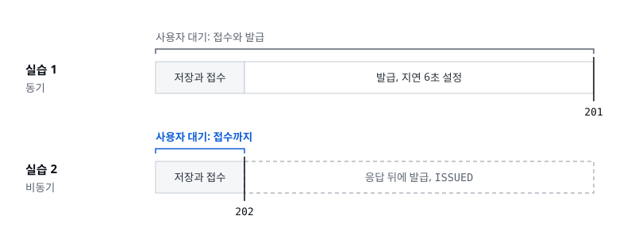
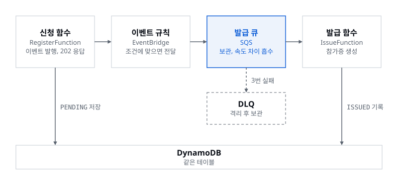
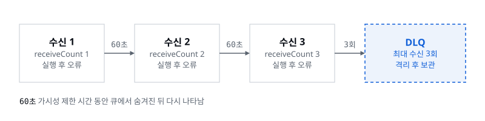
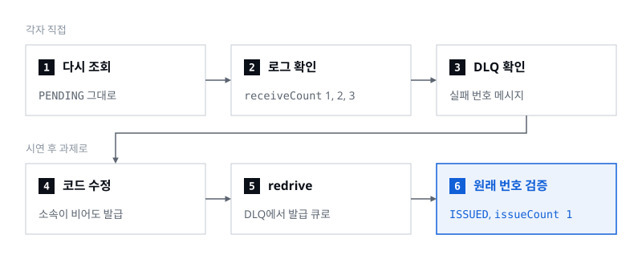

> 202는 접수 확인, 발급은 그 이후에

세션 03의 두 번째 발표와 실습 2를 맡았습니다. 앞 발표에서 본 방식은 신청을 받으면 참가증 발급까지 다 끝낸 뒤에 응답했습니다. 맥도날드로 치면 손님이 햄버거가 나올 때까지 카운터 앞에 서서 기다리는 셈이고, 발급 지연을 6초로 늘리자 사용자도 그만큼 더 기다렸습니다. 이번에는 이걸 주문을 받으면 번호표부터 드리고 햄버거는 그다음에 만드는 방식으로 바꿨습니다.

기다리는 시간은 확 줄지만 새 문제가 생깁니다. 같은 주문서가 두 번 들어오면 어떻게 할지, 햄버거를 만들다 실패하면 어떻게 할지입니다. 이 발표에서 가져갈 것은 네 가지입니다.

- **접수와 완료의 구분:** 202는 접수 확인이고, 발급은 뒤에서 이어집니다.
- **이벤트와 큐:** 일을 보관했다가 전달하고, 속도 차이를 흡수합니다.
- **멱등성:** 같은 일이 두 번 와도 결과는 한 번만 반영합니다.
- **재시도와 DLQ:** 실패하면 다시 시도하고, 계속 실패하면 격리합니다.

## 01. 접수와 완료는 다르다

실습 1의 동기 방식에서는 신청을 저장하고 접수한 뒤 발급까지 끝나야 `201`로 응답합니다. 사용자가 기다리는 시간은 접수와 발급을 더한 만큼입니다. 실습 2의 비동기 방식은 저장하고 접수한 직후 `202`로 응답하고, 발급은 응답 뒤에 처리해 상태를 `ISSUED`로 바꿉니다. 사용자는 접수까지만 기다립니다.



여기서 기억할 점은 **빨라진 건 번호표를 받는 시간이지, 발급 자체가 빨라진 게 아니라는 것**입니다. 발급에는 여전히 설정해 둔 6초가 걸립니다. 그래서 `202`라는 숫자를 번호표라고 기억하면 됩니다. 신청 함수 `register.py`가 돌려주는 202 Accepted는 접수했고 처리는 나중에 한다는 뜻이지, 발급에 성공했다는 뜻이 아닙니다. 신청 화면의 `상세 보기`를 열면 번호표만 받은 신청은 `PENDING`이고, 잠시 뒤 다시 상태를 조회하면 `ISSUED`로 바뀌어 있습니다.

## 02. 접수된 일이 전달되는 길

실습에서 SAM으로 배포한 함수 구성으로 보면 이렇습니다.

1. **신청 함수**(RegisterFunction)는 카운터 직원입니다. 신청을 받으면 DB에 `PENDING`으로 적고, 신청이 들어왔다는 이벤트를 하나 발행한 뒤 바로 `202` 번호표를 줍니다. 사용자가 기다리는 시간은 딱 여기까지입니다.
2. **이벤트 규칙**(EventBridge)은 들어온 주문서를 분류하는 담당입니다. 이벤트가 오면 정해 둔 조건을 보고 어디로 보낼지 정합니다. 이 예제에서는 `source`가 `event-signup.registration`이고 `detail-type`이 `RegistrationReceived`인 이벤트를 발급 큐로 보냅니다.
3. **발급 큐**(SQS)는 주문서가 순서대로 처리되기를 기다리는 곳입니다. 신청이 한꺼번에 몰렸을 때 직원이 감당하지 못하면 오류가 나니, 큐가 일을 보관해 두고 직원이 감당할 수 있게 넘겨줍니다. **보내는 쪽과 처리하는 쪽의 속도 차이를 큐가 흡수**하는 겁니다.
4. **발급 함수**(IssueFunction)는 실제로 참가증을 만드는 직원입니다. 큐에서 주문서를 꺼내 참가증을 만들고, DB의 상태를 `ISSUED`로 바꿉니다. 신청 함수와 발급 함수는 같은 DynamoDB 테이블을 씁니다.
5. **DLQ**는 반복해서 실패한 주문서를 따로 빼 두는 큐입니다. 이 예제에서는 세 번 실패하면 격리하도록 설정했습니다.



참고로 SQS와 짝꿍처럼 함께 나오는 서비스가 SNS입니다. 방송처럼 여러 구독자에게 한 번에 알림을 보내는 서비스인데, 이 예제에서는 쓰지 않았습니다.

## 03. 같은 일이 두 번 와도 결과는 한 번

번호표 방식에서 생기는 첫 번째 문제는 중복입니다. 여기서 필요한 성질이 멱등성(idempotency)입니다. CS 과목에서 많이 나오지만 꽤 낯선 단어인데, **같은 주문서가 두 번, 그 이상 들어와도 결과물은 꼭 하나만 나오는 성질**입니다. 이 예제에서 중복은 두 군데에서 생깁니다.

| | 접수 중복 | 작업 중복 |
|---|---|---|
| 상황 | 같은 신청을 두 번 전송. 신청하기를 두 번 클릭 | 같은 작업이 큐에서 다시 도착 |
| 막는 곳 | `register.py` | `issue.py`의 `save_badge` |
| 방법 | 조건부 저장 `attribute_not_exists(registrationId)` | 조건부 쓰기 `attribute_not_exists(badgeCode)` |
| 결과 | 같은 내용이면 `200`, 새 이벤트 없음. 다른 내용이면 `409` | `badgeCode` 유지, `issueCount = 1` |

접수 중복은 손님이 같은 주문을 카운터에서 두 번 하는 경우입니다. 홈페이지라면 같은 번호로 신청을 두 번 보낸 것이죠. 그대로 두면 오류가 날 수 있어서, 신청 함수가 미리 막습니다. 신청 번호로 조건부 저장을 해서 같은 번호가 이미 있으면 새로 저장하지 않습니다. 내용까지 같으면 `200`과 함께 참가증을 새로 발급하지 않고 기존 결과를 그대로 보여 주고, 번호는 같은데 내용이 다르면 `409`로 충돌이라고 알립니다.

작업 중복은 손님이 아니라 큐 때문에 생깁니다. 주문서가 이미 직원에게 갔는데, 어떤 이유로 같은 주문서가 큐에 한 번 더 오는 경우입니다. SQS Standard 큐는 메시지를 **최소 한 번(at-least-once)** 전달한다고 되어 있습니다. 말장난 같지만, 드물게 같은 메시지를 두 번 전달할 때도 있다는 뜻입니다. 그래서 발급 함수가 DB에 결과를 쓸 때 `badgeCode`가 아직 없을 때만 쓰도록 조건을 걸어, 같은 주문서가 두 번 와도 발급은 한 번만 반영되게 합니다.

## 04. 실패하면 다시, 계속 실패하면 격리

두 번째 문제는 햄버거를 만들다 망가지는 경우입니다. 발급 함수가 주문서를 처음 가져가면, 큐는 그 주문서를 잠깐 숨깁니다. 다른 직원이 같은 주문서를 가져가면 안 되기 때문입니다. 이 시간을 가시성 제한 시간(visibility timeout)이라고 하고, 여기서는 60초로 정했습니다. 발급 함수가 오류로 끝나면 완료 표시를 하지 못했으니, 60초가 지나면 주문서가 큐에 다시 나타납니다. 그러면 다른 직원이든 같은 직원이든 다시 가져갑니다. 이것이 재시도입니다.

가져갈 때마다 수신 횟수(`receiveCount`)가 1, 2, 3으로 늘어납니다. 최대 수신 횟수(`maxReceiveCount`)를 3으로 정해 두었기 때문에, 세 번 실패한 주문서는 DLQ(Dead-Letter Queue)로 옮겨져 격리됩니다. 한국어 콘솔에서는 '배달 못한 편지 대기열'로 번역되어 있습니다.



구현할 때 까다로운 지점은 **실패를 실패라고 알려 줘야 재시도가 일어난다**는 것입니다. 오류를 다시 던져야 Lambda가 실패로 판단합니다. 또 60초씩 세 번을 기다리니 DLQ에서 확인하기까지 대략 3분 이상 걸리고, 정확한 시간은 보장되지 않습니다.

## 05. 설정값과 그 이유

| 설정 | 값 | 의미와 이유 |
|---|---|---|
| Timeout | 10초 | 발급 함수가 한 번 실행되는 최대 시간. 직원 한 명이 쓸 수 있는 시간이고, 10초 안에 못 끝내면 함수가 강제로 끝납니다 |
| Visibility timeout | 60초 | 주문서를 큐에서 숨겨 두는 시간. 함수 Timeout의 6배이고, AWS는 함수 제한 시간의 6배 이상을 권장합니다 |
| maxReceiveCount | 3회 | 첫 수신을 포함한 횟수. 수업 중에 반복 실패를 빨리 보기 위한 낮은 값이고, AWS 권장은 최소 5입니다 |

가시성 제한 시간을 함수 제한 시간보다 넉넉하게 두는 이유는, 직원이 아직 다 만들지 못했는데 주문서가 큐에 다시 나타나면 다른 직원이 또 처리하려 들기 때문입니다. 최대 수신 횟수 3은 실습 안에 DLQ를 확인하려고 낮춘 값이니 운영에 그대로 가져가면 안 됩니다. 장애가 어떤 식으로 나타나는지, 복구에 얼마나 걸리는지를 보고 정합니다. 근거는 AWS의 [Lambda SQS 이벤트 소스 설정 문서](https://docs.aws.amazon.com/lambda/latest/dg/services-sqs-configure.html)입니다. 이번 과제에서도 설정값만 적지 말고, 그 값을 고른 이유와 바꾸면 생기는 영향까지 함께 다뤄 주세요.

## 06. DLQ는 끝이 아닌 복구의 시작

DLQ를 문제 큐라고 하니, 격리되면 끝이라고 생각하는 분도 있습니다. 제 생각에 DLQ는 **복구에 가장 큰 단서를 주는 곳**입니다. 주문서를 쌓아 두기만 하면 아무 일도 일어나지 않지만, 반복해서 실패한 주문서가 여기 모이니 왜 실패했는지 원인을 찾을 수 있습니다.

1. **격리:** 반복 실패한 메시지를 DLQ에 보관합니다.
2. **수정:** 원인을 찾아 고치고 배포합니다.
3. **redrive:** DLQ의 메시지를 발급 큐로 되돌려 다시 처리합니다.

주의할 점은 **수정 없이 redrive하면 같은 오류가 반복된다**는 것입니다. 고친 다음에 돌려보내야 오류가 다시 나지 않습니다.

## 07. 실습: 비동기 처리와 실패 실험

실습 1에서 배포한 행사 신청 서비스를 비동기 구조로 바꾸고, 중복과 실패를 직접 관찰했습니다. 스택에서 흐름을 확인하고(2-1), 접수와 발급이 나뉘는 것을 보고(2-2), 같은 작업을 다시 보내도 결과가 한 번인지 확인한 뒤(2-3), 실패한 신청의 원인을 찾아 원래 번호 그대로 복구합니다(2-4).

준비와 실습 1의 배포는 앞 발표의 실습을 그대로 이어 씁니다. 화면별 캡처와 전체 명령은 운영체제에 맞는 실습 가이드([macOS · Linux · CloudShell](files/hands-on-macos-linux.pdf), [Windows](files/hands-on-windows.pdf))의 2장에 있습니다. 아래 명령은 macOS · Linux · CloudShell 기준이고, Windows PowerShell에서는 가이드의 함수(`Deploy-Step2`, `Show-Logs`, `Start-Redrive` 등)를 씁니다.

### 사전 배포와 실패 신청

발표가 시작될 때 실습 1과 같은 폴더, 스택, 리전으로 배포해 둡니다. 발급 지연은 6초로 맞춰 앞의 실험과 비교합니다.

```bash
make step2 DELAY=6
make url
```

PowerShell에서는 `Deploy-Step2 -Delay 6`입니다. 같은 스택의 기존 테이블과 API를 이어 쓰도록 구성되어 있어서, 배포가 끝나면 Outputs를 다시 확인하고 신청 화면에서 `실습 2 · 비동기`를 고릅니다. 실습 1 데이터와 섞이지 않게 새 신청 번호를 씁니다.

배포가 준비되면 먼저 `오류 실험` → `신청하기`로 한 건을 보냅니다. 소속을 비운 신청이고 응답은 `202`입니다. **이 실패 신청 번호를 따로 적어 둡니다.** 접수는 됐지만 발급은 계속 실패할 신청이라, DLQ에 도착하기까지 몇 분 걸리는 동안 다음 단계를 진행하고 2-4에서 다시 찾아 복구합니다. 그때까지 `issue.py`는 고치지 않습니다.

### 2-1. 스택에서 흐름 확인

CloudFormation → 내 스택 → Resources에서 Logical ID로 행을 찾고, 같은 행의 Physical ID 링크를 누르면 그 리소스 화면으로 갑니다. 발표에서 본 설정이 실제로 이렇게 들어가 있습니다.

| 위치 | Logical ID | 확인할 값 |
|---|---|---|
| EventBridge 내 이벤트 버스 → 규칙 | `RegistrationRule` | `source = event-signup.registration`, `detail-type = RegistrationReceived`, 대상은 발급 큐 |
| SQS 발급 큐 → 설정, Dead-letter queue | `IssueQueue` | Visibility timeout 60초, maxReceiveCount 3, 연결된 DLQ |
| Lambda `IssueFunction` → Configuration → Triggers | `IssueFunction` | SQS 트리거, 한 번에 메시지 1개 |
| Lambda `IssueFunction` → Configuration | `IssueFunction` | Timeout 10초, `ISSUE_DELAY_SECONDS = 6`, `IDEMPOTENT = true` |

한국어 콘솔에서는 Visibility timeout이 '기본 표시 제한 시간'으로, 60초는 '1분'으로, maxReceiveCount는 '최대 수신 수'로 보입니다.

### 2-2. 접수와 발급의 분리

`정상 신청` → `신청하기`로 새 신청을 보내고 번호를 적습니다. 응답은 `202`와 `PENDING`이고, 발급 6초가 끝나기를 기다리지 않고 바로 옵니다. 실제 응답 시간은 콜드 스타트와 네트워크의 영향을 받을 수 있습니다. 잠시 뒤 `ISSUED`와 참가증이 나타나는지 보고, 자동 조회가 멈췄거나 결과가 늦으면 `상태 조회`를 누릅니다. 가이드 화면의 진행 기록에서는 0.5초 만에 `202`를 받았고, 2.3초에 DB에서 `PENDING`, 7.0초에 `ISSUED`를 확인했습니다.

로그는 두 함수를 함께 봅니다. `register`와 `issue` 로그 그룹을 함께 놓고 신청 번호로 검색하면 신청 함수의 `registration_saved`, `event_published`와 발급 함수의 `issue_started`, `badge_saved`가 이어집니다. 터미널에서는 `make logs F=IssueFunction`으로 발급 함수 로그를 실시간으로 볼 수 있는데, 이 시각은 UTC라 한국 시간보다 9시간 이릅니다. 로그가 도착한 순서만으로 처리 순서를 단정하지는 않습니다.

화면의 `HTTP 응답`과 `응답 시간`은 마지막 신청 또는 재전송 요청의 결과라서 다음 요청을 보내면 덮어써집니다. 과제에 쓸 캡처는 재전송 전에 남겨 둡니다. 최초 응답은 `202`, 나중의 DB 결과는 `ISSUED`와 `issueCount = 1`이면 접수와 발급이 나뉜 것입니다.

### 2-3. 같은 작업을 다시 보내기

정상 신청이 `ISSUED`가 되면 `badgeCode`와 `issueCount`를 적고 `작업 재전송`을 누릅니다. 저장된 신청으로 새 이벤트를 보내, 같은 작업이 발급 큐로 다시 들어온 상황을 만드는 버튼입니다. 잠시 뒤 상태를 조회하면 참가증 코드는 그대로이고 `issueCount`도 `1`입니다. 발급 함수 로그에는 이미 발급된 작업을 건너뛰었다는 `badge_already_issued_skip`이 남고, 그 조건은 `step2/src/issue.py`의 `save_badge`에서 찾을 수 있습니다. 이벤트는 다시 왔지만 DB의 발급 결과는 한 번만 반영됐고, 이것이 이 예제가 보장하는 멱등성의 범위입니다.

시간이 남으면 선택 실험도 해 봅니다.

| 선택 | 방법 | 결과 |
|---|---|---|
| 접수 중복 | 같은 내용, 같은 번호로 `신청하기`를 다시 누른다 | 접수 단계에서 막혀 `200`, 새 이벤트 없음 |
| 충돌 | 같은 번호로 이름, 이메일, 소속을 바꿔 보낸다 | `409`, 원래 신청은 바뀌지 않음 |
| 멱등성 끄기 | 발급 함수의 `IDEMPOTENT`를 `false`로 바꾸고 새 신청과 작업 재전송을 비교한다 | 발급 횟수가 늘 수 있음. 끝나면 반드시 `true`로 복원 |

### 2-4. 실패 원인을 찾아 복구하기

처음에 보낸 실패 신청을 원래 번호 그대로 복구하는 여섯 단계입니다. ①–③은 각자 직접 하고, ④–⑥은 발표자 시연으로 보여 준 뒤 과제의 권장 항목으로 각자 이어서 합니다.



1. **다시 조회:** 적어 둔 실패 번호를 신청 번호 칸에 넣고 `상태 조회`를 하면 `PENDING`이 그대로 남아 있습니다. 상태 조회만으로는 실패 원인이 보이지 않습니다.
2. **로그:** 발급 함수 로그에서 실패 번호를 찾으면 `issue_started`의 `receiveCount`가 1, 2, 3으로 늘고, 매번 `issue_failed`에 오류 종류(`errorType`)와 내용(`error`)이 남습니다. 오류의 추적 정보에서 파일과 줄도 찾습니다. 소속은 신청 화면에서 '선택' 항목인데, 발급 함수는 소속이 반드시 있다고 가정하고 있습니다. 입력의 선택 항목과 발급 코드가 기대하는 데이터가 맞는지 비교해 봅니다.
3. **DLQ:** SQS → 해당 DLQ → Send and receive messages → Poll for messages에서 메시지 Body의 신청 번호를 확인합니다. 반복 실패한 메시지만 격리되고, 그동안 다른 정상 신청은 `ISSUED`로 처리됩니다. **메시지는 지우지 않습니다.** 원본 발급 큐를 콘솔에서 직접 Poll하면 수신 횟수와 처리에 영향을 주니 발급 큐는 로그로 관찰합니다. 터미널의 `make dlq`는 DLQ의 메시지 수를, `make dlq-peek`는 내용을 보여 주는데, `make dlq-peek`도 수신 횟수를 늘리니 반복해서 실행하지 않습니다.
4. **코드 수정:** 소속은 선택 입력으로 유지하고, 비어 있어도 참가증이 정상 발급되도록 `step2/src/issue.py`를 고칩니다. 로컬에서 테스트한 뒤 다시 배포합니다. 수정 전에는 `make test-exercise`가 실패하는 것이 정상이고, 수정 후에는 두 테스트가 모두 통과해야 합니다.
5. **재처리:** DLQ의 메시지를 이 스택의 발급 큐로 되돌리고 진행 상태를 봅니다. 콘솔에서는 DLQ → Start DLQ redrive에서 목적지 큐로 이 스택의 `IssueQueue`를 지정합니다.
6. **검증:** 새로 신청하지 않고 원래 실패 번호로 `상태 조회`를 해서 `ISSUED`, `issueCount = 1`을 확인합니다. 큐의 메시지 수는 근삿값이라 DB 결과와 로그도 함께 봅니다.

④와 ⑤에서 쓰는 명령입니다. PowerShell에서는 테스트를 `py -m unittest -b tests.test_handlers -v`와 `py -m unittest -b tests.test_exercise -v`로, 배포와 재처리를 `Deploy-Step2 -Delay 6`, `Start-Redrive`, `Show-Redrive`로 합니다.

```bash
make test
make test-exercise
make step2 DELAY=6
make redrive
make redrive-status
```

④–⑥을 과제로 이어서 하려면 스택을 지우지 않고 둡니다. 실패 번호와 DLQ 메시지가 그 스택에 있기 때문입니다.

### 과제로 남길 기록

핸즈온에서 확인한 네 가지가 과제의 완료 조건 C1–C4로 그대로 이어집니다. 증거는 시연 화면이 아니라 내 스택에서 직접 캡처합니다.

| 조건 | 가이드 | 남길 증거 |
|---|---|---|
| C1 요청 흐름 | 2-1, 2-2 | Resources의 5개 서비스, 두 로그의 같은 신청 번호, `ISSUED`와 `badgeCode` |
| C2 접수와 처리의 분리 | 2-2 | `202`, 6초보다 훨씬 짧은 응답 시간, `PENDING`에서 `ISSUED`로 바뀐 상태 |
| C3 중복 반영 방지 | 2-3 | 재전송 뒤에도 유지된 `badgeCode`와 `issueCount = 1`, 로그의 `badge_already_issued_skip` |
| C4 실패 격리 | 2-4 ①–③ | 오류 로그, `receiveCount` 증가, DLQ에 도착한 실패 번호, 그동안 `ISSUED`가 된 정상 신청 |

과제는 자율 참여이고 제출 마감은 2026-11-17 21:00(KST)입니다. 내 아키텍처 그림과 서비스별 역할, Timeout 10초와 Visibility 60초, 최대 수신 횟수 3 같은 설정값과 선택 이유, 정상·중복·실패 각각의 입력과 예상 결과, 실제 결과를 함께 적습니다. 복구까지 확인한 뒤에는 같은 스택 이름과 리전으로 `make delete`를 실행하고, 연습용 IAM 사용자의 액세스 키와 `AdministratorAccess`도 정리합니다.

번호표를 먼저 주면 사용자는 빨리 답을 받지만, 그 뒤에서 일이 두 번 오거나 실패하는 경우까지 설계해야 합니다. 오늘 본 멱등성과 재시도, DLQ가 그 설계의 출발점입니다.
